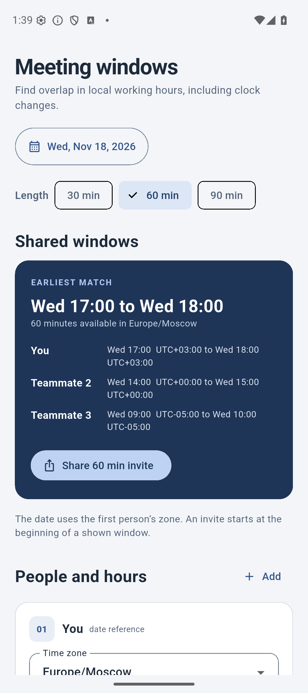

# Meeting Window

Finding a call time gets awkward when each person's working day starts in a different time zone. Meeting Window checks the hours on a chosen date and shows intervals that work for everyone. It accounts for clock changes, including the missing hour in spring and the repeated hour in autumn.

The app runs on Android and in a browser. It needs no account or calendar permission. You can export a selected start time as an `.ics` invitation and share it through another app.

[Try the web app](https://musyase.github.io/meeting-window/) | [Download the Android demo](https://github.com/musyase/meeting-window/releases)



## Try a case

The initial setup uses Moscow, London, and New York, with 09:00 to 18:00 local hours. Pick a date and choose a 30, 60, or 90 minute meeting. The result shows the same interval in each person's local time with its UTC offset. Change a zone or working hour and the windows recalculate. Add a fourth person if needed. The app saves people, hours, and duration on the device.

For a clock change, set the first person to New York, set their hours to 01:00 to 03:00, and pick March 8, 2026. The 02:00 hour does not exist that day. On November 1, 2026, the 01:00 hour occurs twice. The [domain tests](test/window_finder_test.dart) cover both cases.

## Run locally

Requires Flutter 3.50 or newer and its Android or web toolchain.

```bash
flutter pub get
flutter run -d chrome
# or
flutter run -d <android-device>
```

To run the checks:

```bash
flutter analyze
flutter test
flutter build web --base-href /meeting-window/ --no-web-resources-cdn
flutter build apk --debug
python scripts/check_copy.py README.md
```

`lib/window_finder.dart` checks candidate UTC instants against each person's local hours. Working in UTC avoids inventing a time in a daylight saving gap or dropping one of the repeated instants. `lib/main.dart` keeps device preferences and shares the calendar file. `lib/widgets.dart` renders the phone and wide screen layouts.

## Current scope

Meeting Window supports two to four people from a curated list of 12 IANA time zones. Hours must start and end on the same local day, on whole hours. It finds windows within one calendar day in the first person's zone and checks starts in 15 minute steps. The `.ics` file contains the chosen start and meeting duration. It does not send invitations or read existing calendars, so busy events are not included. The Android download is a debug signed demo build for portfolio review, not a Play Store release.
